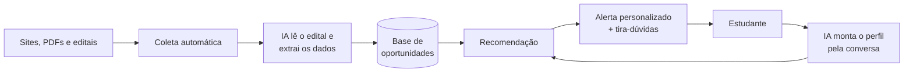

# Se liga AÍ

**IA que faz da oportunidade um direito, não uma questão de sorte.**

O Se liga AÍ é uma ferramenta open source que conecta o interesse de cada estudante às maiores oportunidades educacionais do Brasil: bolsas de estudo, olimpíadas, cursinhos gratuitos, intercâmbios e programas de formação. Ela encontra as oportunidades, explica cada uma em linguagem simples e avisa o estudante certo antes de o prazo acabar.

> 🚧 Projeto em desenvolvimento.

---

## O problema

No Brasil, oportunidade ainda é questão de sorte.

As oportunidades existem, mas estão espalhadas em centenas de sites de universidades, fundações e governos, publicadas em PDFs longos, com linguagem técnica e prazos curtos. Muitas são divulgadas só nas redes de quem já faz parte desse circuito.

Quem estuda em escola particular, mora em uma capital ou tem família com ensino superior recebe essas dicas de professores, cursinhos e amigos. Quem estuda em escola pública, especialmente no interior, na maioria das vezes não tem a quem perguntar.

O resultado é uma desigualdade silenciosa: **o talento está distribuído por todo o país, mas a informação não está.** Um estudante com perfil para uma bolsa integral deixa de se inscrever porque nunca soube que ela existia, ou descobriu depois do prazo.

Nós três crescemos no interior e sentimos isso na pele. Só ao nos mudarmos para João Pessoa percebemos quantas portas sempre estiveram abertas, mas longe do nosso alcance.

## A solução

Um assistente que vai até o estudante, nos canais que ele já usa (como o WhatsApp), em vez de esperar que ele saiba o que procurar.



## Como a IA é usada

| Etapa | O que faz | Técnica |
|---|---|---|
| **1. Leitura de editais** | Lê PDFs e páginas e extrai quem pode participar, benefícios, documentos e prazos | Modelo de linguagem com saída estruturada (JSON validado) |
| **2. Perfil por conversa** | O estudante conta, com suas palavras, onde estuda, em que série está e do que gosta | Extração de informações em linguagem natural |
| **3. Recomendação** | Filtra as oportunidades em que o estudante é elegível e prioriza as mais alinhadas aos seus interesses | Regras de elegibilidade + similaridade semântica (embeddings) |
| **4. Tira-dúvidas** | Responde perguntas como "preciso de quê para me inscrever?" por texto ou áudio | Busca no texto do edital (RAG) + transcrição de áudio |

### IA confiável por design

- **Toda informação tem fonte.** Cada dado extraído fica ligado ao trecho original do edital, para que possa ser verificado.
- **Elegibilidade por regras, não por adivinhação.** Quem pode participar é decidido por regras objetivas. A IA prioriza e explica, mas não decide sozinha.
- **Revisão humana** quando o modelo não tem certeza de algum campo.

## Exemplo de dado extraído

```json
{
  "titulo": "Programa de bolsas X",
  "tipo": "bolsa",
  "beneficio": "bolsa integral + auxílio moradia",
  "requisitos": {
    "escolaridade": "3º ano do ensino médio",
    "escola_publica": true,
    "estados": ["todos"]
  },
  "inscricao_ate": "2026-11-15",
  "documentos": ["histórico escolar", "comprovante de renda"],
  "link": "https://...",
  "trechos_fonte": {
    "inscricao_ate": "As inscrições vão até 15 de novembro de 2026..."
  }
}
```

## Dados públicos

Além das oportunidades, usamos dados abertos para medir o tamanho do problema e priorizar regiões:

- **INEP**: microdados do Enem e do Censo Escolar
- **MEC / dados.gov.br**: bolsistas do Prouni por município de origem
- **IBGE**: população e renda por município

## Stack prevista

- **Backend:** Python + FastAPI
- **Banco de dados:** PostgreSQL + pgvector
- **Coleta:** Playwright, pdfplumber e OCR para PDFs escaneados
- **IA:** modelos de linguagem com saída estruturada, embeddings e transcrição de áudio
- **Canal:** WhatsApp Cloud API (protótipo em Telegram)

## Roadmap

- [ ] Pipeline de leitura de editais com extração estruturada
- [ ] Base inicial com 30 a 50 oportunidades reais
- [ ] Assistente com criação de perfil por conversa
- [ ] Recomendação por elegibilidade e interesse
- [ ] Alertas de novas oportunidades e de prazos
- [ ] Tira-dúvidas baseado no texto do edital
- [ ] Análise dos dados do INEP sobre desigualdade de acesso
- [ ] Teste com estudantes de escolas públicas do interior

## Privacidade

Grande parte do público é menor de idade. Por isso:

- coletamos o **mínimo de dados** necessário (nada de CPF);
- pedimos **consentimento** e explicamos para que cada dado serve;
- seguimos a **LGPD**.

## Visão

Por ser aberta, a ferramenta pode ser adotada por escolas, ONGs e secretarias de educação. No futuro, um dos caminhos que queremos construir é torná-la parte de políticas públicas, para que nenhuma oportunidade deixe de chegar a quem tem direito a ela.

## Time

| Nome | Origem | Responsabilidade |
|---|---|---|
| Giorgio Nícolas de Arruda Bertino | Timbaúba (PE) | Coleta de oportunidades e leitura de editais com IA |
| Carlos Eduardo da Silva Souto Maior | Timbaúba (PE) | Experiência do estudante: conversa, perfil e tira-dúvidas |
| Marcus Vinícius da Silva Araujo | Ferreiros (PE) | Recomendação, dados do INEP e métricas de impacto |

## Licença

Distribuído sob a licença MIT. Veja [LICENSE](LICENSE).
